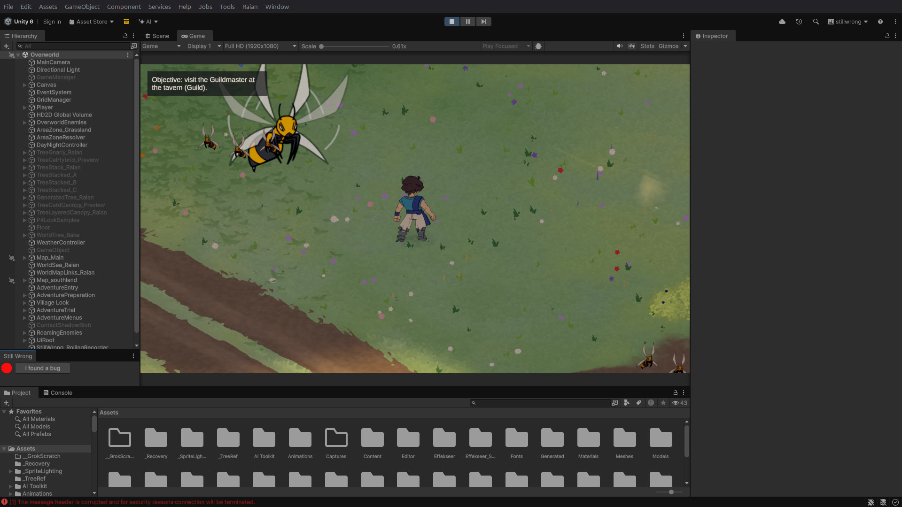
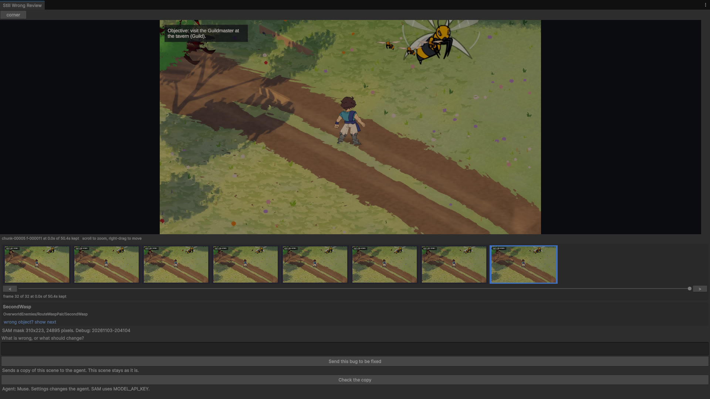
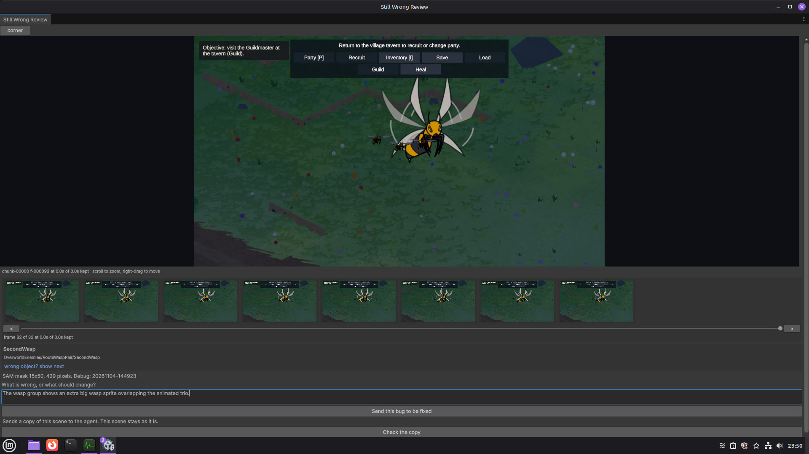

# StillWrong

StillWrong is a Unity Editor package for the moment you see a bug while playing your own game.

For those tired of describing the full thing they want changed in games to an AI chat, now you can literally just click at it which simplifies the process, it will not stay wrong after you ask for a fix.
The AI will not guess what it needs to do anymore.

You press **I found a bug**, click the thing that looks wrong, write one sentence, and send it. An agent fixes a copy of the scene on its own git branch. You check the copy, and if it looks right you put the fix into your scene.

It was built for the Meta Global AI Developer Hackathon (Oct to Nov 2026) and uses SAM 3.1 and Muse Spark through the Meta Model API.

## The loop

1. **Background recorder.** While you play in the Editor, StillWrong keeps a rolling loop of the last few minutes as 10 second chunks. The default is 3 minutes (setting: 1 to 10). Older chunks are deleted as play goes on. A red dot in the docked Still Wrong tab shows it is recording.
2. **I found a bug.** One click pauses the game and opens the Review window on the recorded frames. You scrub back to the frame that shows the problem.
3. **Click the object.** StillWrong sends the frame and your click to SAM 3.1, which returns a mask of the object you clicked. The mask and the click are matched against the scene to name the GameObject (for example `OverworldEnemies/RouteWaspPair/SecondWasp`).
4. **One sentence.** You say what is wrong or what should change.
5. **Send.** StillWrong reduces a copy of the scene, writes a fix packet, creates a `stillwrong/<object>` git branch with a worktree next to the project, and copies the reduced scene into it. The agent (Muse by default, set in Tools > Still Wrong > Settings) works only in that copy. Your scene stays as it is.
6. **Check the copy.** Open the agent's changed copy and look at the result.
7. **Put the fix in my scene.** Applies the change to your scene, with a backup of the original first.

## Install

Requirements: Unity 6 (developed on 6000.5.5f1), git on PATH, the project inside a git repository, and a Meta Model API key.

1. Copy `Packages/com.stillwrong.reducer` into your project's `Packages/` folder, or add it in Package Manager with *Add package from disk* and pick its `package.json`.
2. Set `MODEL_API_KEY` in the environment that starts Unity. On Linux and macOS the Editor also reads `~/.config/muse/meta-api-key` if the variable is not set.
3. Open **Tools > Still Wrong**, dock the tab, enter Play Mode and play.

This repository is also a small Unity project you can open directly. `Assets/Fixtures` holds the test scenes (UI clip, sorting occlusion, a transient disappearance, a held-out billboard case, and a busy demo scene with a planted bug).

## How the Meta models are used

- **SAM 3.1** (Meta Model API) turns the click on a recorded frame into a pixel mask of that object. The package decodes the returned one-bit mask itself (`Runtime/Meta/MaskCodec.cs`) and uses it to rank candidate GameObjects. In our test on a real game frame, the mask covered exactly the wasp that was clicked.
- **Muse Spark** (Meta Model API) writes the check that describes the bug in engine terms, and as the agent it edits the reduced scene copy. In our run it fixed the extra wasp sprite by setting `SecondWasp` `m_IsActive` from 1 to 0 in the copy.

## Limits

- On recorded frames the object ranking with the SAM mask is currently the same as the ranking without it. The mask is correct, but the ranking does not yet use it to change the order. Work on a mask-and-ID-buffer ranking is in progress.
- The recorder is not lightweight yet. On our test scene the Editor update averaged 34.5 ms with recording off and 101.6 ms with it on.
- The Send step reduces the scene by running trials. On a large scene this can take a long time.
- A fix made by the agent is a proposal. Check the copy before putting it in your scene.
- Tested on Linux only.

## Disclosure

StillWrong was designed for this hackathon. Planning and early scaffolding (the core reducer, its offline tests, and the Unity fixture builders) were written from 20 to 26 October 2026, after acceptance and before kickoff. The product integration was built during the hackathon window. All code is my own work. Third-party licences are listed in NOTICE. No assets from the game shown in the demo video are included in this repository.

## Licence

MIT, see LICENSE. The mask codec follows the SAM License, see NOTICE and SAM-LICENSE.
