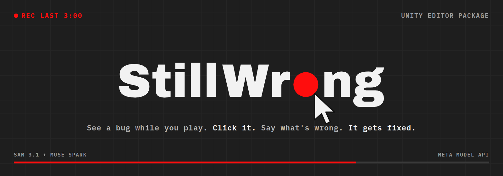
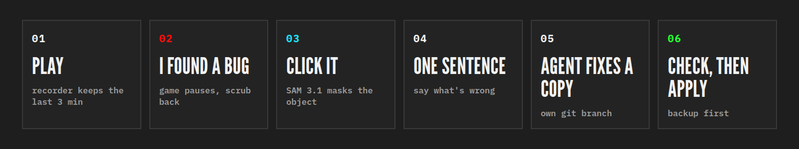

<b>See a bug while you play. Click it. Say what's wrong. It gets fixed.</b>

Unity Editor package &nbsp;·&nbsp; SAM 3.1 + Muse Spark &nbsp;·&nbsp; Meta Model API &nbsp;·&nbsp; MIT

## Demo video

<a href="https://youtu.be/UY9kle7WmNs">Watch the 2:29 demo on YouTube</a>

# StillWrong

StillWrong is a Unity Editor package for the moment you see a bug while playing your own game.

## Why it exists

For those tired of describing the full thing they want changed in a game to an AI chat: now you can just click on it. That makes the process simpler, and the thing will not stay wrong after you ask for a fix. The AI does not have to guess what it needs to do anymore.

Today a visual bug in a game goes like this. You stop playing, try to remember what happened, find the object in a hierarchy of hundreds, and write a long message about it. The AI gets text, not the frame you saw. It guesses which object you mean and often changes the wrong one, so the bug is still wrong.

StillWrong replaces that description with the evidence. The recorder already has the frame. Your click names the exact GameObject. Your sentence says what should change. The agent gets all three and works on a copy, so a wrong guess never touches your scene.

## How it works

You press **I found a bug**, click the thing that looks wrong, write one sentence, and send it. An agent fixes a copy of the scene on its own git branch. You check the copy, and if it looks right you put the fix into your scene.

It was built for the Meta Global AI Developer Hackathon (Oct to Nov 2026) and uses SAM 3.1 and Muse Spark through the Meta Model API.

## The loop in detail

1. **Background recorder.** While you play in the Editor, StillWrong keeps a rolling loop of the last few minutes as 10 second chunks. The default is 3 minutes (setting: 1 to 10). Older chunks are deleted as play goes on. A red dot in the docked Still Wrong tab shows it is recording.
2. **I found a bug.** One click pauses the game and opens the Review window on the recorded frames. You scrub back to the frame that shows the problem.
3. **Click the object.** StillWrong sends the frame and your click to SAM 3.1, which returns a mask of the object you clicked. While you play, the recorder also saves which objects were on screen every few frames (`objects.tsv` in each chunk). The mask is matched against the objects saved with that frame, so the pick reflects what you saw, even if the scene has moved on since. The mask is drawn over the frame in cyan so you can see what SAM outlined.
4. **One sentence.** You say what is wrong or what should change.
5. **Send.** StillWrong reduces a copy of the scene, writes a fix packet, creates a `stillwrong/<object>` git branch with a worktree next to the project, and copies the reduced scene into it. The agent (Muse by default, set in Tools > Still Wrong > Settings) works only in that copy. Your scene stays as it is.
6. **Check the copy.** Open the agent's changed copy and look at the result.
7. **Put the fix in my scene.** Applies the change to your scene, with a backup of the original first.

## Install

Requirements: Unity 6 (developed on 6000.5.5f1), git on PATH, the project inside a git repository, and a Meta Model API key.

1. Copy `Packages/com.stillwrong.reducer` into your project's `Packages/` folder, or add it in Package Manager with *Add package from disk* and pick its `package.json`.
2. Set `MODEL_API_KEY` in the environment that starts Unity. On Linux and macOS the Editor also reads `~/.config/muse/meta-api-key` if the variable is not set.
3. Open **Tools > Still Wrong**, dock the tab, enter Play Mode and play.

This repository is also a small Unity project you can open directly. `Assets/Fixtures` holds the test scenes (UI clip, sorting occlusion, a transient disappearance, a held-out billboard case, and a busy demo scene with a planted bug).

## How the Meta models are used

- **SAM 3.1** (Meta Model API) turns the click on a recorded frame into a pixel mask of that object. The package decodes the returned one-bit mask itself (`Runtime/Meta/MaskCodec.cs`) and ranks the recorded objects by how well their screen rect matches the mask (intersection over union, `Runtime/Core/MaskRanker.cs`). Objects much larger than the mask, such as ground or full-screen panels, are dropped. Near ties go to the object drawn in front, and a parent wins over a child with the same outline.
- **Overlapping objects.** When two sprites are drawn over each other, SAM can outline both as one shape. StillWrong spots this when the mask spills outside the best match or also covers most of a smaller object. It then asks SAM again with a negative point on the swallowed object, so the second mask leaves it out, and keeps whichever mask matches better. If the click itself sits on the smaller object, the pick is marked as uncertain so you can switch to it.
- **Muse Spark** (Meta Model API) writes the check that describes the bug in engine terms, and as the agent it edits the reduced scene copy. In our run it fixed the extra wasp sprite by setting `SecondWasp` `m_IsActive` from 1 to 0 in the copy.

## Limits

- Object matching uses screen rects, not exact pixel outlines, so two objects with nearly the same rect can still need a manual pick. The ranking logic has offline tests (`Packages/com.stillwrong.reducer/Tests~/MaskRankerTests`, run with `dotnet run`).
- **Live SAM 3.1 check on a recorded frame of the demo bug.** Clicking the oversized wasp returned a 14,659 px mask that also took in the small swarm wasp beside it. StillWrong still named the big wasp first, flagged the merge and asked SAM again with a negative point on the small wasp. The second mask covered only the big wasp's head, so it was rejected and the first pick kept. Clicking the small wasp returned a 908 px mask and named the small wasp. Object rects in this check were measured by hand from the frame, not taken from a live recording.
- The recorder used to encode each frame to JPEG on the main thread. On our test scene the Editor update averaged 34.5 ms with recording off and 101.6 ms with it on. Encoding and disk writes now run on two background threads, and the Game view grab reuses one texture. In a 1080p benchmark in Unity 6000.5.5f1, main-thread cost per frame fell from 36.0 ms to 0.64 ms (6.4 ms worst case), with all 60 frames written and none dropped. The full Play Mode budget run has not been repeated since this change.
- The Send step reduces the scene by running trials, and each trial reloads the scene copy, which takes a second or two on a large scene. It now tries whole branches from the scene root first and skips branches already removed with a parent. In an offline simulation of a 4,579-object scene where the bug needs only the target, this cut the trial count from 933 to 33 (`Packages/com.stillwrong.reducer/Tests~/ReductionSimTests`). In Unity 6000.5.5f1, the same shape of scene built from real GameObjects (4,578 objects, bug needing the target and one light) reduced to 6 objects in 39 trials and 5.7 seconds, with the bug still present. Those objects are mostly empty, so each trial took 0.15 s; on the real Overworld scene a trial took about 1.7 s, which puts 39 trials near a minute. The real Overworld scene has not been re-timed yet.
- A fix made by the agent is a proposal. Check the copy before putting it in your scene.
- Tested on Linux only.

## Disclosure

StillWrong was designed for this hackathon. Planning and early scaffolding (the core reducer, its offline tests, and the Unity fixture builders) were written from 20 to 26 October 2026, after acceptance and before kickoff. The product integration was built during the hackathon window. All code is my own work. Third-party licences are listed in NOTICE. No assets from the game shown in the demo video are included in this repository.

## Licence

MIT, see LICENSE. The mask codec follows the SAM License, see NOTICE and SAM-LICENSE.
